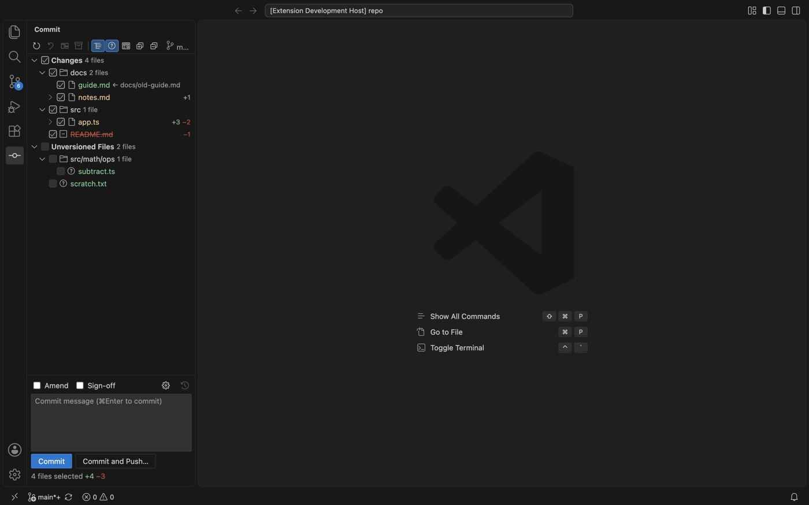
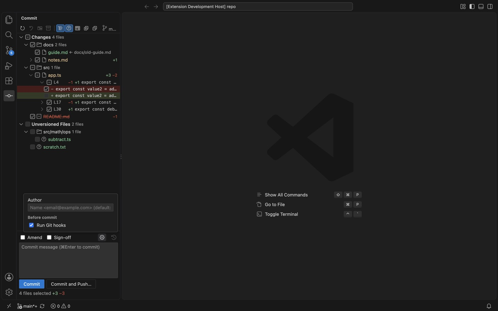
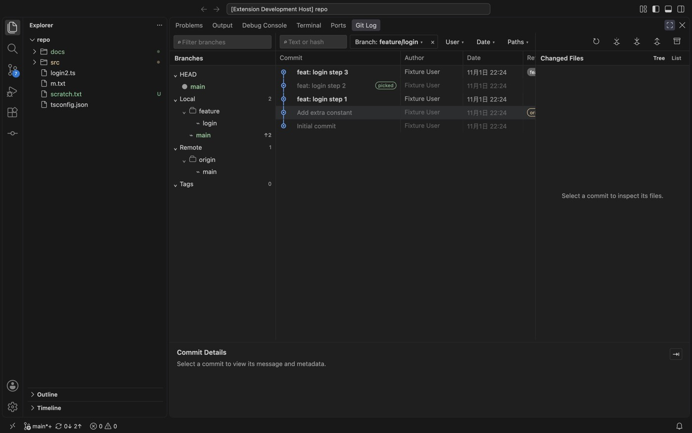
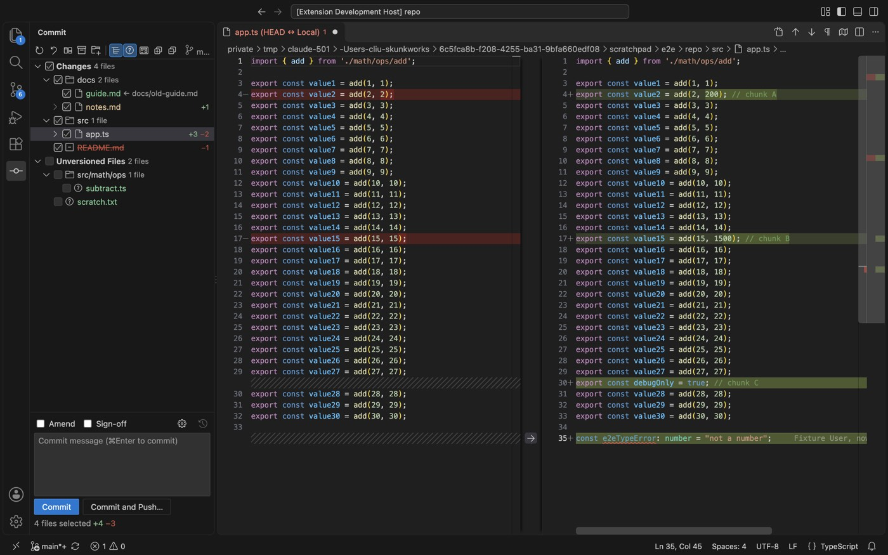
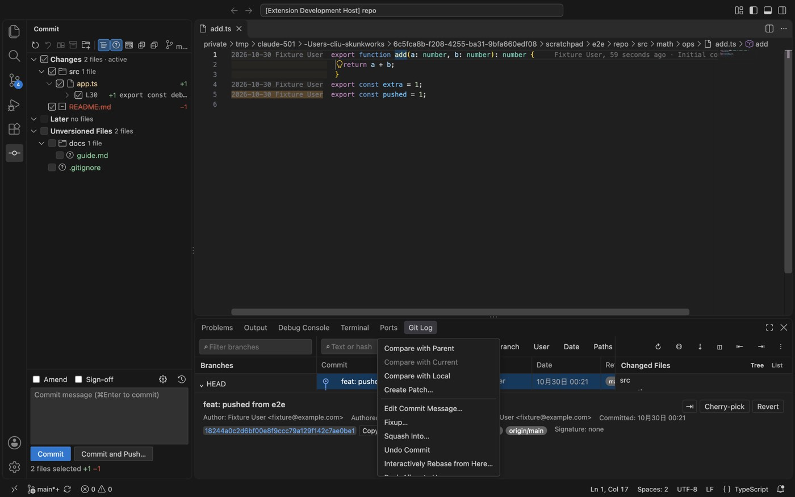
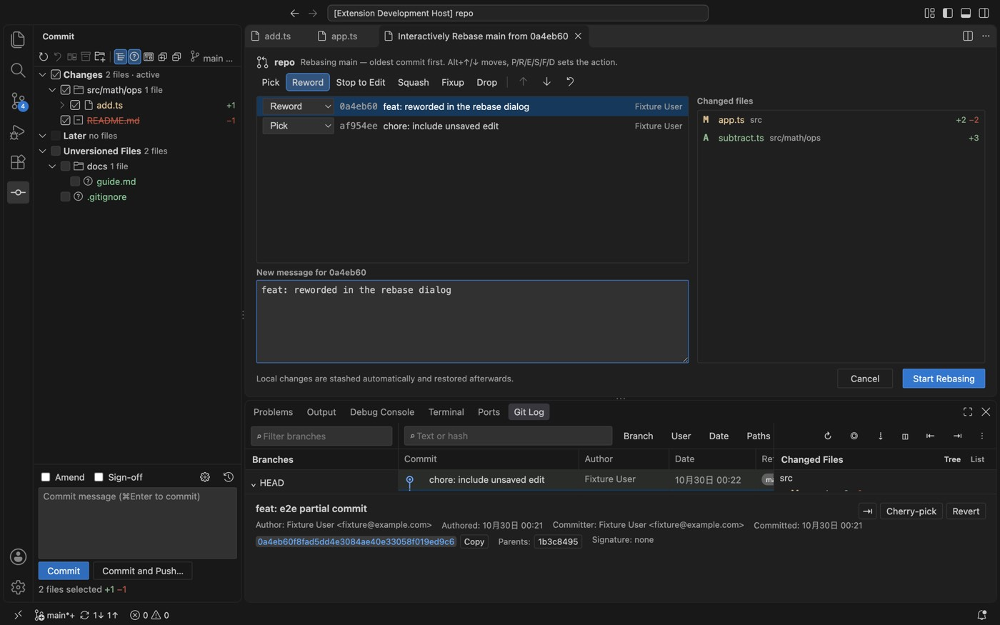
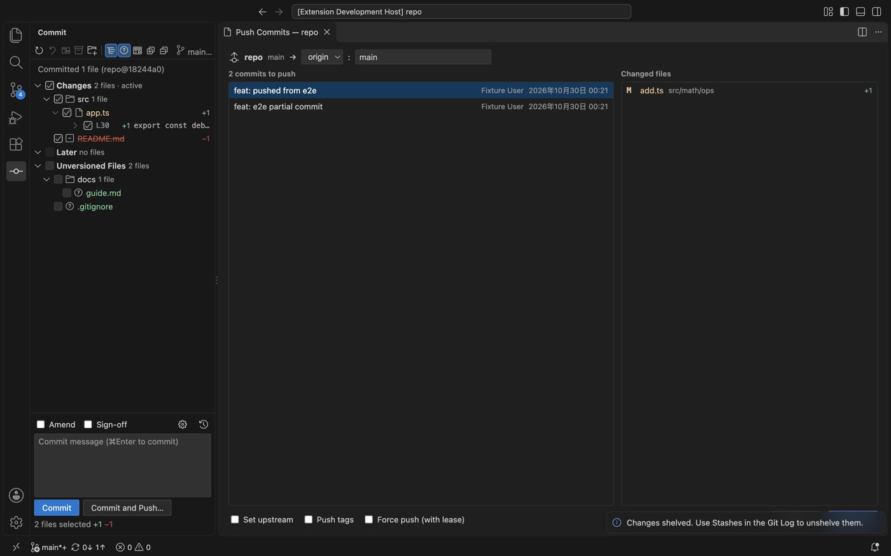
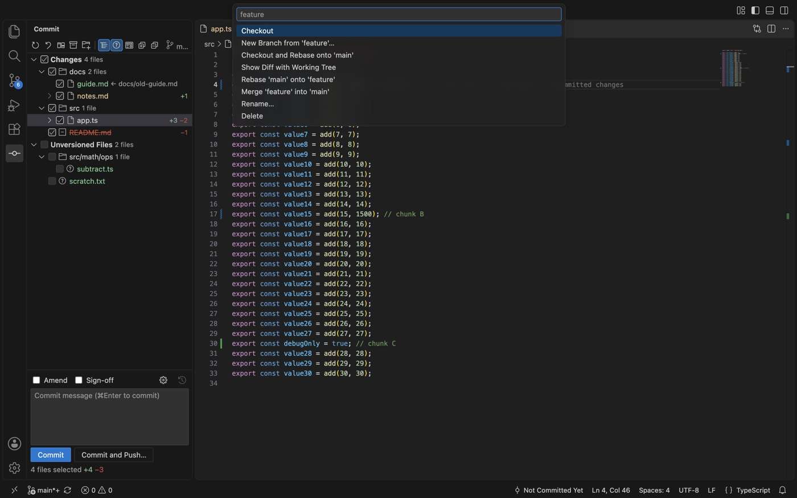
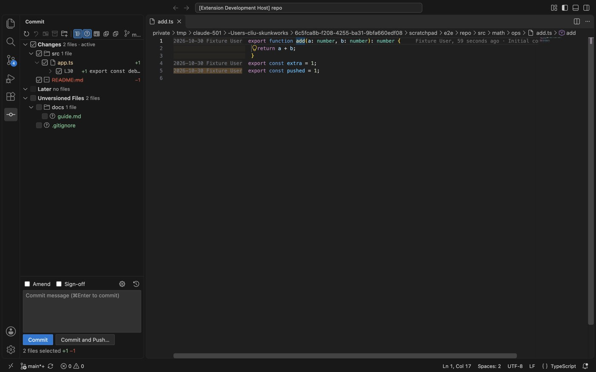

<p align="center"></p>

<h1 align="center">Git Log Plus</h1>

<p align="center">IDE-grade Git for Cursor and VS Code: a real Commit window, a Log that shows how branches differ, and diffs you can edit.</p>

<p align="center">
  <a href="https://open-vsx.org/extension/daliuchen/git-log-plus"></a>
  &nbsp;<a href="README.md">简体中文</a> | English
</p>



## What it solves

The built-in Source Control view is fine for `git add` + `git commit`. Everyday work needs more:

- **Commit part of your changes** — one of three edits in a file, or a few lines — without touching the staging area.
- **Edit code while reviewing a diff** — the right side is the real file, so go to definition, rename and diagnostics keep working.
- **See how two branches differ** — which commits of another branch you already have, which were cherry-picked, and which are still missing.
- **Stay out of the terminal** — rebase, reword, undo, cherry-pick and push from menus and dialogs, and continue or abort from the UI when something stops halfway.

Built on [ascenx/vscode-git-log](https://github.com/ascenx/vscode-git-log) (MIT); the commit graph, file history, line history and blame of the original are all kept.

## Installation

**Marketplace**: search for **Git Log Plus** in the Extensions view of Cursor (or VS Code / VSCodium) and install `daliuchen.git-log-plus`.

**VSIX**: download it from [GitHub Releases](https://github.com/daliuchen/git-log-plus/releases) and run *Extensions: Install from VSIX…*, or:

```bash
cursor --install-extension git-log-plus-0.3.0.vsix   # or: code --install-extension …
```

> Uninstall the original **Git Log** (`ascenx.git-log`) first; both register the same views and commands.

Requires VS Code 1.85+ (any current Cursor) and Git 2.27+. Run *Developer: Reload Window* after installing.

## Quick start

1. **Open the Commit window** — in Cursor the activity bar sits on top of the side bar; if the Commit icon is hidden, open the **⌄** at the end of the row. Or run `Git Log: Commit…`, or bind ⌘9 (see [Keyboard shortcuts](#keyboard-shortcuts)).
2. **Commit** — check files or folders (tracked changes are checked by default), double-click a file (or `⌘D`) to review its diff and edit the real file on the right, write a message, `⌘Enter`. `⌘⌥Enter` is **Commit and Push…**. What gets committed is the working-tree content of the checked items, regardless of the index (`git commit --only`).
3. **Commit part of a file** — expand it to check single chunks; expand a chunk to check single lines.
4. **Browse and compare** — open the **Git Log** tab (`Git Log: Open Log`) and click a branch. While another branch is shown, commits the current branch lacks are **bold**, ones it already has are dimmed, and ones already cherry-picked are dimmed and tagged **picked**.





## Common tasks

| I want to… | How |
| --- | --- |
| Commit a few files | Check them in the Commit window → message → `⌘Enter` |
| Commit some chunks or lines | Expand the file (and the chunk) and check only those |
| Commit just the change under the cursor | Editor right-click → *Git Log → Commit This Change…* |
| Fix the last commit | Check **Amend** (loads the last message), or editor right-click → *Git Log → Amend This Change into Last Commit* |
| Undo the last commit, keep the changes | Log → right-click → **Undo Commit** |
| Reword an older commit | Log → right-click → **Edit Commit Message…** (working tree untouched) |
| Squash / reorder / drop commits | Log → right-click the oldest one → **Interactively Rebase from Here…** |
| Rebase my branch onto master | **Fetch**, then right-click `origin/master` in the branch list → **Rebase Current onto**, or **Pull into Current Using Rebase** |
| See what master has that I don't (or the reverse) | Right-click the branch → **Compare with Current**, or hover it in the **Branch** filter and click **←** / **→**; **⇄** swaps. Already cherry-picked commits are left out |
| Compare the files of two branches | Branch right-click → **Show Diff with Current** |
| Take a commit from another branch | Show that branch → right-click the commit → **Cherry-pick**. If its change is already there you are told so instead of getting stuck |
| Take a few files from a commit | Select it → right-click files in Changed Files → **Cherry-Pick Selected Changes** / **Get from Revision** |
| Resolve rebase / cherry-pick / merge conflicts | Use *Merge… / Accept Yours / Accept Theirs / Mark as Resolved* in the Commit window, then **Continue** (or **Skip** / **Abort**) in the bar of the Commit window or the Log |
| Push | Toolbar **Push…** or **Commit and Push…**. Without a remote you are asked to define one; a rejected push offers **Rebase and Push** / **Merge and Push** |
| Pull / fetch | Toolbar **Pull**; **Fetch** only updates remote branches |
| Put work aside | Right-click → **Shelve Changes…** (only the selected files) |
| Discard changes | Right-click → **Rollback…** (`⌘⌥Z`), optionally deleting added files |
| Jump from an old revision to the real file | **F4** |
| See who changed each line | Editor right-click → *Git Log → Annotate with Git Blame* |

## Features

**Commit window** — directory tree or flat list; Changes / Merge Conflicts / Unversioned Files groups; tri-state checkboxes down to single lines; message history, drafts, Amend, Sign-off; options for Author and Run Git hooks; Shelve, Rollback, Add to VCS, Add to .gitignore, Delete, Show History; conflict actions; a banner with Continue / Skip / Abort while a rebase, cherry-pick or revert is in progress.

**Editable diffs** — HEAD ↔ the real file from the Commit window; the real file on the right in the Log whenever it matches the commit; F4 Jump to Source from read-only revisions.

**Log** — toolbar with Refresh, Fetch, Pull, Push…, Stashes; filter buttons that show their value and clear with ×; a searchable Branch filter with ← / → compare; commit, file and branch context menus (reword, fixup/squash, undo, interactive rebase, push up to here, cherry-pick, revert, patches, per-file revert/cherry-pick/get/drop, checkout and rebase, rebase/merge onto, pull into current, update, compare).

**Dialogs** — interactive rebase, Push (define remote, set upstream, tags, force with lease, rejected-push retry), Branches popup.

**Annotate** — author and date beside each line, shaded by age, including uncommitted lines.













## Keyboard shortcuts

| Key | Where | Action |
| --- | --- | --- |
| `⌘Enter` / `⌘⌥Enter` | Commit message | Commit / Commit and Push… |
| `⌘D` | Commit window | Show Diff |
| `⌘⌥Z` | Commit window | Rollback… |
| `F4` | Read-only diff, Commit window | Jump to Source |
| `P R E S F D`, `⌥↑/↓` | Rebase dialog | Change action, reorder |

To open the Commit window with ⌘9 (and hide the side bar on a second press), add to *Preferences: Open Keyboard Shortcuts (JSON)*:

```json
[
  { "key": "cmd+9", "command": "gitLogWorkbench.commit.open", "when": "activeViewlet != 'workbench.view.extension.gitLogCommit'" },
  { "key": "cmd+9", "command": "workbench.action.toggleSidebarVisibility", "when": "activeViewlet == 'workbench.view.extension.gitLogCommit'" }
]
```

## How it works

- Everything goes through the Git CLI — no shell, no stored credentials.
- Partial commits use a temporary index (`GIT_INDEX_FILE`) built from HEAD with only the selected chunks and lines; the staging area is never used as input.
- Branch comparison uses `git log --cherry-pick --left-only/--right-only HEAD...branch`; cherry-picked commits are found with `git rev-list --cherry-mark`.

## Development

```bash
asdf install
pnpm install
pnpm run typecheck && pnpm run lint && pnpm run test:unit
pnpm run test:integration
pnpm run package
```

Contribution rules (pull requests, design notes before features, code style): [AGENTS.md](AGENTS.md).

## How this was built

The code was written mostly by AI ([Claude Code](https://claude.com/claude-code)). The author decided what to build and how it should behave, and uses it day to day; every change passed type checks, lint, unit tests and VS Code integration tests, and the main flows were tried in a real editor. Issues are welcome.

## License

[MIT](LICENSE).
