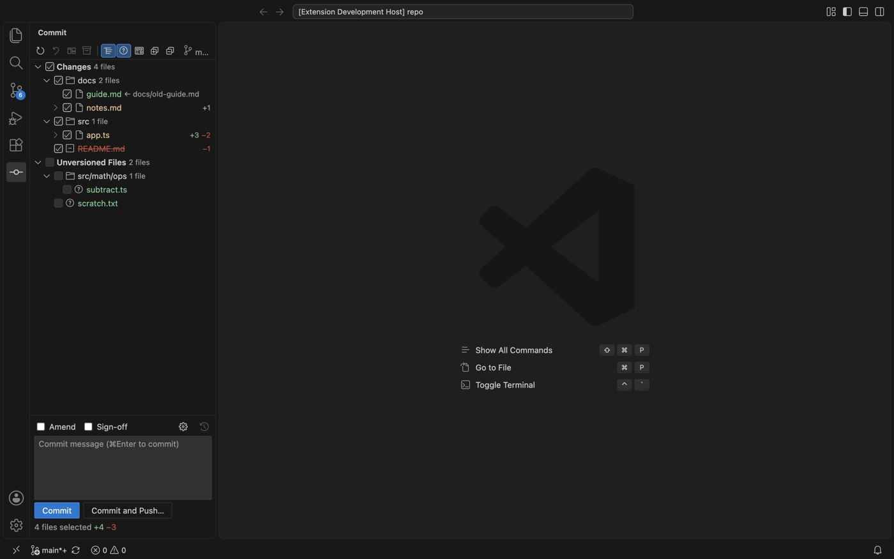
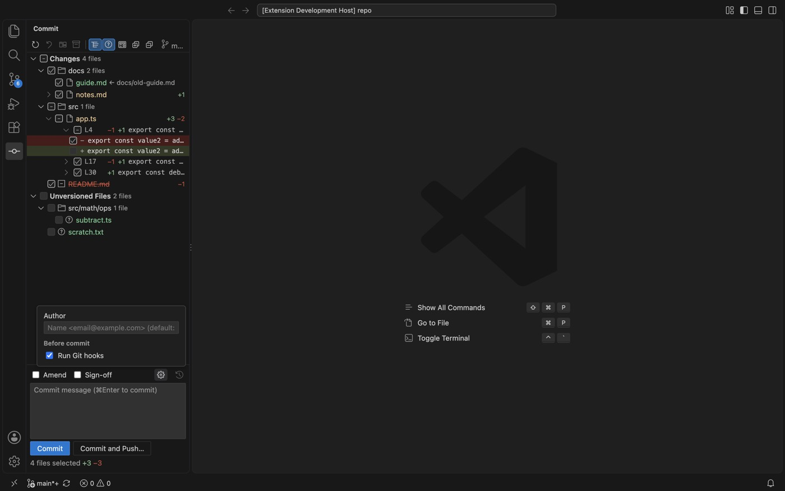
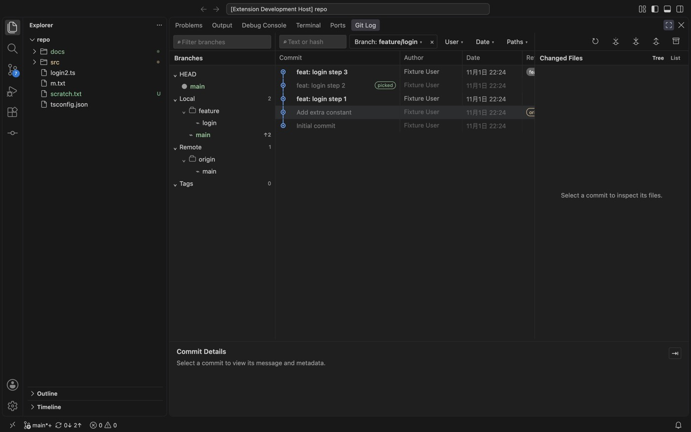
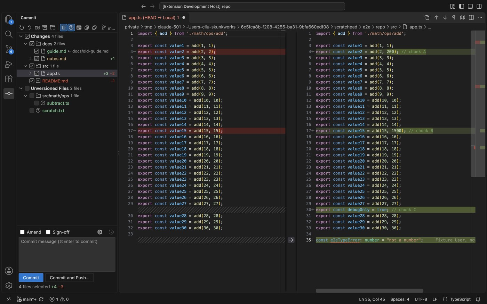
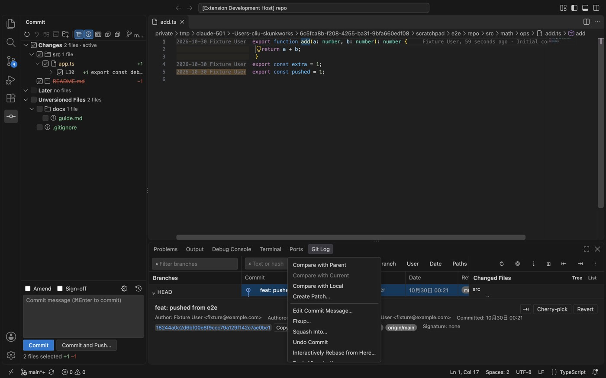
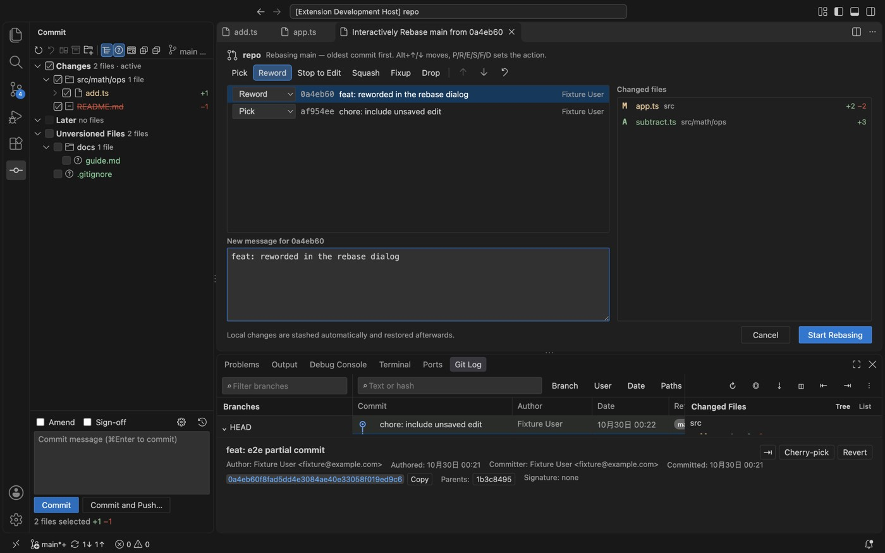
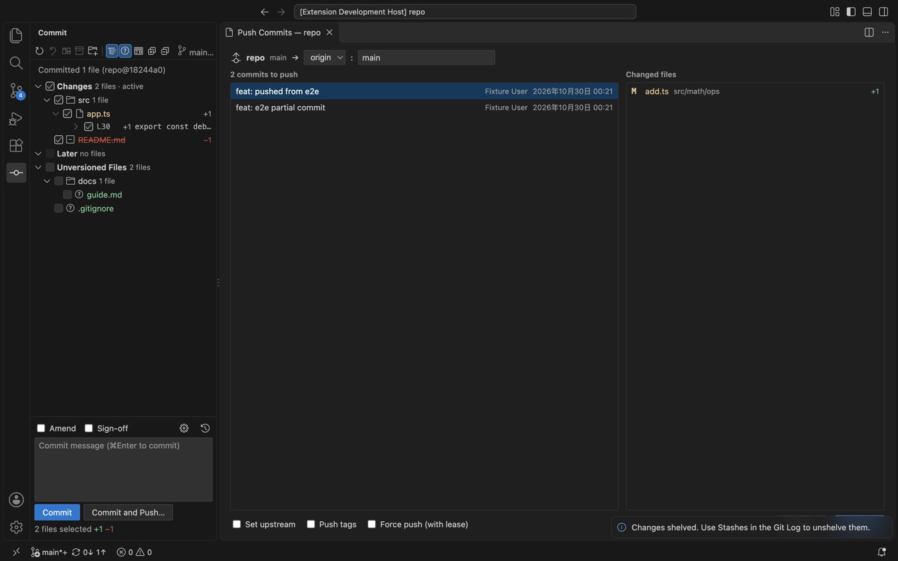
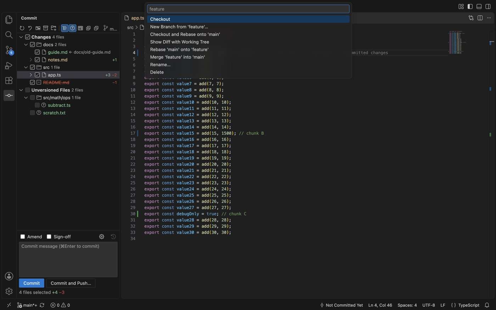
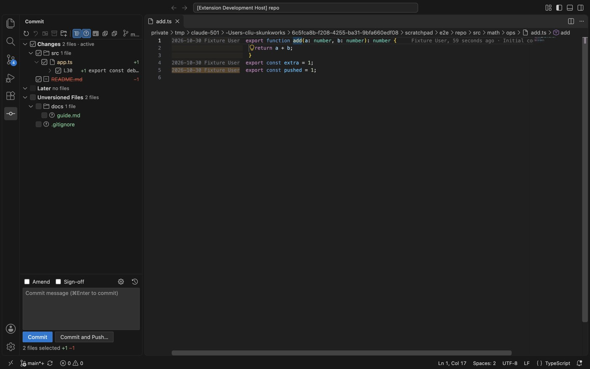

<p align="center"></p>

<h1 align="center">Git Log Plus</h1>

<p align="center">在 Cursor / VS Code 里用上 IDE 级的 Git：真正的 Commit 窗口、能看清分支差别的 Log、可编辑的 Diff。</p>

<p align="center">
  <a href="https://open-vsx.org/extension/daliuchen/git-log-plus"></a>
  &nbsp;简体中文 | <a href="README.en.md">English</a>
</p>



## 它解决什么问题

编辑器自带的「源代码管理」只适合 `git add` + `git commit`。日常开发里更常见的是下面这些需求，它做不到或者很别扭：

- **只提交一部分改动**：一个文件里改了三处，只想提交其中一处，甚至某几行；而且不想碰暂存区。
- **看 Diff 时能直接改代码**：Diff 右侧就是真实文件，跳转定义、重命名、报错提示照常可用。
- **看清楚两个分支差在哪**：另一个分支上哪些提交我已经有了、哪些已经 cherry-pick 过、哪些还没有。
- **常用 Git 操作不用切终端**：rebase、改提交信息、撤销提交、cherry-pick、推送都在菜单和对话框里完成，中途卡住也能在界面里继续或放弃。

Git Log Plus 基于 [ascenx/vscode-git-log](https://github.com/ascenx/vscode-git-log)（MIT）改造，原版的提交图谱、文件历史、行历史、Blame 等功能全部保留。

## 安装

**从扩展市场安装**：在 Cursor（或 VS Code、VSCodium）的扩展面板搜索 **Git Log Plus**，安装 `daliuchen.git-log-plus`。

**用安装包安装**：从 [GitHub Releases](https://github.com/daliuchen/git-log-plus/releases) 下载 `.vsix`，执行命令 *Extensions: Install from VSIX…*，或者：

```bash
cursor --install-extension git-log-plus-0.3.0.vsix   # VS Code 用 code --install-extension
```

> 如果装过原版 **Git Log**（`ascenx.git-log`），请先卸载：两者注册了同样的视图和命令。

要求 VS Code 1.85 及以上（当前各版本 Cursor 都满足）、Git 2.27 及以上。安装后执行一次 *Developer: Reload Window*。

## 五分钟上手

### 1. 打开 Commit 窗口

- **Cursor**：活动栏横在侧边栏顶部。看不到 Commit 图标时，点图标那一排最右边的 **⌄**，选 **Commit**。
- **VS Code**：点左侧活动栏的 **Commit** 图标。
- **任何地方**：命令面板 → `Git Log: Commit…`。
- **快捷键**：推荐把 ⌘9 绑定到它，见下文[快捷键](#快捷键)。

### 2. 提交

1. 勾选要提交的文件或目录。已跟踪文件的改动默认都勾上，未跟踪的新文件默认不勾。
2. 双击文件（或 `⌘D`）看 Diff。右侧就是真实文件，发现问题直接改。
3. 写好提交信息，`⌘Enter` 提交；`⌘⌥Enter` 是 **Commit and Push…**。

提交的是**勾选内容在工作区里的样子**，和暂存区无关（等同于 `git commit --only`）。

### 3. 只提交一部分

展开修改过的文件，每个改动块都有自己的勾选框；再展开改动块，可以逐行勾选。没勾的块和行留在本地，不会被提交。



### 4. 看历史、比分支

底部面板的 **Git Log** 标签（`Git Log: Open Log`）。点左侧的分支查看它的提交；提交、文件、分支上右键有各种操作。



查看别的分支时，每个提交都会标出当前分支有没有它：**加粗**的是当前分支还没有的；**变灰**的是当前分支已经有的；**变灰并标 picked** 的是已经 cherry-pick 过来的（提交号不同，但改动内容一样）。

## 常见操作

| 我想… | 怎么做 |
| --- | --- |
| 提交几个文件 | Commit 窗口里勾上 → 写信息 → `⌘Enter` |
| 只提交文件里的某几块、某几行 | Commit 窗口里展开文件（再展开改动块），只勾需要的 |
| 只提交光标处这一处改动 | 编辑器右键 → *Git Log → Commit This Change…* |
| 修改上一个提交 | 勾 **Amend**（自动带出上次的提交信息）再提交；或编辑器右键 → *Git Log → Amend This Change into Last Commit* |
| 撤销上一个提交、保留改动 | Log 里右键该提交 → **Undo Commit**，提交信息会回到 Commit 窗口 |
| 改某个旧提交的信息 | Log 里右键该提交 → **Edit Commit Message…**，不会动工作区 |
| squash、调整顺序、删除提交 | Log 里右键要改的最早那个提交 → **Interactively Rebase from Here…** |
| 把我的分支 rebase 到 master | 先点工具栏的 Fetch，再在左侧分支列表右键 `origin/master` → **Rebase Current onto**；或者右键 → **Pull into Current Using Rebase**，一步完成 fetch + rebase |
| 看 master 有、我没有的提交（或反过来） | 左侧分支列表右键该分支 → **Compare with Current**；或在 **Branch** 筛选里把鼠标移到分支上，点 **←**（它有我没有）或 **→**（我有它没有）。筛选按钮上的 **⇄** 切换方向。已经 cherry-pick 过的提交不会再出现 |
| 看两个分支的文件差异 | 分支右键 → **Show Diff with Current** |
| 把别的分支的某个提交拿过来 | 查看那个分支 → 右键提交 → **Cherry-pick**。改动已经存在时会直接提示「已应用」，不会卡住 |
| 只拿某个提交里的几个文件 | 选中提交 → 在 Changed Files 里右键文件 → **Cherry-Pick Selected Changes** / **Get from Revision** |
| 解决 rebase / cherry-pick / merge 冲突 | 冲突文件在 Commit 窗口单独成组：*Merge…*、*Accept Yours*、*Accept Theirs*、*Mark as Resolved*；然后点 Commit 窗口或 Log 顶部提示条的 **Continue**（或 **Skip** / **Abort**） |
| 推送 | 工具栏 **Push…** 或 Commit 窗口的 **Commit and Push…**。仓库还没有远程时会让你先定义一个；被拒绝时可以选 **Rebase and Push** / **Merge and Push**；rebase 过的分支要勾 *Force push (with lease)* |
| 拉取 | 工具栏 **Pull**；只想更新远程分支信息、不动本地分支就点 **Fetch** |
| 把改动先收起来 | 文件右键 → **Shelve Changes…**，只收选中的文件；在 Log 工具栏的 Stashes 里取回 |
| 丢弃本地改动 | 右键 → **Rollback…**（`⌘⌥Z`），新增的文件可以顺便删掉 |
| 从只读的历史版本跳到真实文件 | 按 **F4**（或 Diff 工具栏上的按钮） |
| 看每行是谁改的 | 编辑器右键 → *Git Log → Annotate with Git Blame* |
| 切换、新建、删除分支 | `Git Log: Branches…` |

## 功能详解

### Commit 窗口

- 改动按**目录树**显示，单个子目录的链会合并（例如 `src/commit`），也可以切换成平铺；多个仓库时按仓库分组。
- 分三组：**Changes**（已跟踪文件的改动）、**Merge Conflicts**、**Unversioned Files**（可隐藏）。
- 分组、目录、文件、改动块、行都有**三态勾选框**。
- 提交信息带**历史记录**，草稿按工作区保存；支持 **Amend**、**Sign-off**。
- 齿轮里是**提交选项**：指定 Author、是否运行 Git hooks（不勾就是 `--no-verify`）。
- 文件右键：Show Diff（`⌘D`）、Jump to Source（F4）、Commit File…、Rollback…（`⌘⌥Z`）、Shelve Changes…、Add to VCS、Add to .gitignore、Delete、Show History、Copy Path；冲突文件还有 Merge…、Accept Yours、Accept Theirs、Mark as Resolved。
- rebase、cherry-pick、revert 进行中时，顶部提示条会说明当前状态和下一步，并带 **Continue / Skip / Abort**；merge 时带 Abort。

### 能编辑的 Diff

- Commit 窗口里打开的 Diff 是 HEAD ↔ **真实文件**：右侧可以直接编辑，跳转定义、重命名、报错提示都能用。
- Log 里打开的 Diff，只要该文件在提交里的版本和工作区一致，右侧也用真实文件。
- 任何只读的历史版本都可以 **Jump to Source**（F4），打开本地文件并定位到对应行。



### Log

- **工具栏**：刷新、Fetch、Pull、Push…、Stashes。
- **筛选**：文本或 hash、Branch、User、Date、Paths。每个筛选按钮直接显示当前的值（例如 `Branch: feature/x`），点 × 清除。
- **Branch 筛选**：可以搜索，按本地 / 远程 / 标签分组；点分支名只看这一个分支，勾选框可以同时选多个；鼠标移到分支上出现 **← / →**，用来和当前分支对比。
- **分支对比**：只列出一边有、另一边没有的提交，已经 cherry-pick 过的会排除；查看单个其他分支时，当前分支已有的提交变灰，已摘过的标 picked。
- **提交右键**：Edit Commit Message…、Fixup… / Squash Into…（在 Commit 窗口预填 `fixup!` / `squash!`）、Undo Commit、Interactively Rebase from Here…、Push All up to Here…、Cherry-pick、Revert、Create Patch…、Compare with Local。
- **文件右键**：Compare with Local、Jump to Source、Show History for File、Revert / Cherry-Pick Selected Changes、Get from Revision、Drop Selected Changes…（把这个文件的改动从该提交里去掉）、Create Patch…。
- **分支右键**：Checkout、Checkout and Rebase onto Current、Rebase Current onto、Merge into Current、Pull into Current Using Rebase/Merge、Update（不切换分支直接快进）、Compare with Current、Show Diff with Current、Show Diff with Working Tree。



### 对话框

- **交互式 Rebase**：pick / reword / edit / squash / fixup / drop，`⌥↑/↓` 调整顺序，快捷键 P/R/E/S/F/D；squash 组的提交信息合并后可编辑；本地改动自动 stash。
- **Push**：列出待推送的提交和文件；可以改远程和目标分支（不存在时标 New）；Set upstream、Push tags、Force push with lease；仓库没有远程时先定义远程；被拒绝时可选 Rebase and Push / Merge and Push。
- **Branches 弹窗**（`Git Log: Branches…`）：Checkout、New Branch from…、Checkout and Rebase、Compare with Current、Rebase、Merge、Update、Push、Rename、Delete、Pull Using Rebase/Merge。







### Annotate with Git Blame

编辑器（或行号区）右键 → *Git Log → Annotate with Git Blame*：每行旁边显示作者和日期，按新旧着色，未提交的行也会标出；鼠标悬停可以看提交信息、Show Diff、Copy Hash。



## 命令

| 命令 | 作用 |
| --- | --- |
| `Git Log: Commit…` | 打开 Commit 窗口 |
| `Git Log: Open Log` | 打开 Git Log 标签 |
| `Git Log: Branches…` | 分支弹窗 |
| `Git Log: Push…` | Push 对话框 |
| `Git Log: Update Project…` | 以 rebase 或 merge 方式 pull，自动 stash 本地改动 |

## 快捷键

| 按键 | 位置 | 作用 |
| --- | --- | --- |
| `⌘Enter` | 提交信息框 | 提交 |
| `⌘⌥Enter` | 提交信息框 | Commit and Push… |
| `⌘D` | Commit 窗口 | Show Diff |
| `⌘⌥Z` | Commit 窗口 | Rollback… |
| `F4` | 只读 Diff / Commit 窗口 | Jump to Source |
| `P R E S F D`、`⌥↑/↓` | Rebase 对话框 | 改动作、调整顺序 |

推荐自己加上 ⌘9 打开 Commit 窗口（再按一次收起侧边栏）。打开命令 *Preferences: Open Keyboard Shortcuts (JSON)*，加入：

```json
[
  { "key": "cmd+9", "command": "gitLogWorkbench.commit.open", "when": "activeViewlet != 'workbench.view.extension.gitLogCommit'" },
  { "key": "cmd+9", "command": "workbench.action.toggleSidebarVisibility", "when": "activeViewlet == 'workbench.view.extension.gitLogCommit'" }
]
```

用户快捷键的优先级高于其他扩展，所以就算装了把 ⌘9 绑到「源代码管理」的快捷键扩展，这两条也会生效。Windows / Linux 把 `cmd` 换成 `alt`。

## 设置

| 设置 | 默认值 | 说明 |
| --- | --- | --- |
| `gitLogWorkbench.git.path` | `"git"` | Git 可执行文件路径 |
| `gitLogWorkbench.currentLineBlame.enabled` | `true` | 在光标所在行后显示 blame |
| `gitLogWorkbench.lineHistory.contextLines` | `3` | 行历史里改动上下各显示几行 |
| `gitLogWorkbench.repositories.scanDepth` | `2` | 查找嵌套仓库的目录深度 |
| `gitLogWorkbench.log.pageSize` | `500` | Log 每页加载的提交数 |

## 实现方式

- 所有操作都通过 Git 命令行完成：不经过 shell，不保存任何凭据，认证交给 Git 自己（credential helper / SSH agent）。
- 部分提交用一个临时索引（`GIT_INDEX_FILE`）：从 HEAD 建出来，只应用选中的块和行，用它提交，再把真实索引里这些路径同步过来。暂存区不会被当作提交内容。
- 交互式 rebase 用生成好的 todo 列表执行 `git rebase -i`；reword 和 squash 的信息通过 `git commit --amend` 步骤写入。
- 分支对比用 `git log --cherry-pick --left-only/--right-only HEAD...分支`；判断「已经摘过」用 `git rev-list --cherry-mark`（按改动内容比较）。

## 本地开发

```bash
asdf install        # 按 .tool-versions 安装 Node
pnpm install
pnpm run typecheck
pnpm run lint
pnpm run test:unit
pnpm run test:integration   # 下载 VS Code 1.85.2 跑集成测试
pnpm run package            # 生成 git-log-plus-<版本>.vsix
```

开发规范（提 PR、做需求前写技术方案、代码风格）见 [AGENTS.md](AGENTS.md)。

## 许可证

[MIT](LICENSE)，与原版相同。

---

<details>
<summary><strong>原版 Git Log 的功能说明（全部保留）</strong></summary>

## Log 截图

### Git Log 主界面


### 当前行 Blame 与编辑器菜单


### 文件历史


### 行历史


### 与分支或标签比较


## 核心原则

1. 优先提供高信息密度、清晰且高效的 Git 日志操作路径。
2. Git CLI 是仓库数据和操作的最终事实来源。
3. 编辑、Diff 和合并尽量复用 VS Code 原生能力。
4. 大仓库必须采用分页、缓存和虚拟滚动，不能一次读取完整历史。
5. 所有破坏性操作都必须展示明确目标、影响范围和确认步骤。
6. 每个实施阶段都必须有自动化测试和可执行验收命令。

## 已实现的 Git Log 功能

```text
┌─────────────────────────────────────────────────────────────────────┐
│ Ref filter │ Text/hash │ Branch │ User │ Date │ Paths │ Actions   │
├─────────────┬───────────────────────────────────┬───────────────────┤
│ HEAD        │ Commit graph                      │ Changed files     │
│ Local       │ ● fix: ...        main   Alice   │ src/              │
│   main      │ │\                                │   extension.ts    │
│   feature   │ │ ● feat: ...     feature Bob    │ package.json      │
│ Remote      │ ●─┘ refactor: ...                 │                   │
│ Tags        │                                   │                   │
├─────────────┴───────────────────────────────────┴───────────────────┤
│ Commit message │ hash │ author │ date │ parents │ action toolbar    │
└─────────────────────────────────────────────────────────────────────┘
```

当前版本已经覆盖实施路线的 Milestone 0–6，以及 Milestone 7 中的编辑器历史专项：

- 多根工作区仓库发现，支持普通仓库、bare repository、linked worktree 和 detached HEAD。刷新仓库时会复用未变化的 Git 元数据监听器，包括 linked worktree 之间的共享监听器。
- 远程分支菜单提供 `Checkout (Detached HEAD)`，无需创建本地分支即可检出。游离 HEAD 菜单支持 `Switch Back`（`git switch -`）和 `Create Branch and Checkout…`（`git switch -c <新分支名>`）；这些操作会清空 Branch 筛选、保留其他筛选，并定位 HEAD，以便显示后续本地提交。
- 游离 HEAD 菜单和顶部更多操作提供 `Push HEAD…`，可选择已配置的 Remote 和已有或新目标分支，以 `HEAD:refs/heads/<分支名>` 推送，无需创建本地分支；非快进更新由 Git 拒绝（[#5](https://github.com/ascenx/vscode-git-log/issues/5)）。
- Refs / Commit Graph / Changed Files / Commit Details 四区联动。
- Branch 筛选提供 `All` 和 `HEAD (local)` 快捷选项：`All` 可一起选中 Local、Remote、Tag 引用，支持超过 100 个引用，并可逐项取消选择；`HEAD (local)` 显示当前 HEAD 的历史，包括游离 HEAD，同时保留其他日志筛选。
- Branch 区域提供独立搜索，并将名称中带 `/` 的 Local、Remote、Tag 引用递归分组为可展开/收起的文件夹；本身包含 `/` 的 Remote 名称仍作为独立的顶层文件夹。
- Git Log 作为 VS Code 底部 Panel 的独立 Tab 展示，与问题、输出、终端等工具窗口并列；点击 `Open Log` 会直接聚焦该 Tab，不再打开编辑器页或经过中间欢迎页。
- 分页日志、有界滑动窗口、自定义 DAG lane、跨窗口 graph continuation、固定行高虚拟滚动和大列表性能基准；深分页的全局 offset、选择和相对滚动位置可恢复。
- Text/Hash、Branch、User、Date、Path 组合过滤，旧查询取消和过期响应拒绝；仓库状态刷新不会覆盖正在编辑的搜索草稿；文本查询按 canonical `git log --date-order` 顺序扫描完整正文、作者姓名与邮箱，并且只返回匹配的 Commit。隐藏提交的祖先关系会直接投影到匹配结果上，使分支线保持连续，同时不插入无关 Merge Commit 或多余 Lane。
- Root、Merge、Rename、Copy、Binary 等 changed-files 场景及 VS Code 原生 Diff；多选 Commit 时会合并展示所有选中 Commit 的变更文件，并为每个文件保留正确的 Commit 与 Parent 上下文。详情查询最多并发处理 4 个选中 Commit，并通过有界缓存复用成功结果；刷新仓库时清除缓存，同时保留选择顺序和最新引用标签。
- Checkout、Checkout Revision、Branch、Tag、Fetch、Pull、Push、Cherry-pick、Revert、Merge、Rebase、Reset、Rename/Delete Branch，以及 Commit/Local/Remote/Tag/HEAD 对应的上下文菜单。Rebase 进行中会显示独立状态行及 `Continue`、`Skip`、`Abort` 操作；所有冲突标记解决后才会启用 `Continue`。
- 提供完整 Stash 管理：可选择是否包含未跟踪文件，并支持查看 Stash 变更、Apply、Pop 和确认后 Drop。
- 单击或双击分支只会选择该分支并展示对应 Commit，不会自动 Checkout；Checkout 保留在 Ref 右键菜单中，必须显式执行。
- 支持使用 Shift+单击或 Shift+方向键连续多选 Commit，也可使用 Ctrl/Cmd+单击逐个切换非连续选区；Changed Files 会合并所有选中 Commit，`Drop commits…` 和 `Squash commits…` 仍仅对连续选区开放。Squash 输入框会按界面从上到下预填所有选中 Commit 的完整消息。历史改写要求工作区干净并二次确认，同时拒绝 Root Commit、Merge Commit、过期选区，以及确认期间发生的当前分支或 HEAD 变化。
- 非当前 Local Branch 的右键菜单提供需要二次确认的 `Force Delete…`；普通删除因分支未合并而失败时，也会提供警告色的强制删除恢复按钮。错误提示固定展示五秒后自动关闭。
- 同 common Git dir 写操作串行、按仓库维护 Webview in-flight 锁、危险操作模态确认、Git 错误分类、脱敏 Output Channel 和完成后重新读取 Git 状态。工作区重新扫描期间会保留进行中的操作锁，操作后刷新被取消也不会让右键菜单操作一直锁定。
- Pane/Column 拖动、Pane 折叠与 workspace 宽高持久化；Commit Details 可在全宽底部和 Changed Files 底部之间切换，位置会跨面板会话保留；Commit、Author、Date、Refs 四列固定展示，深分页选择和滚动位置可在重开面板后恢复。
- Commit 与 Refs 等表格列的分隔线可直接拖动并持久化宽度；Changed Files 支持深路径横向滚动，增删行数分别使用绿色和红色。
- Changed Files 单击预览、Tree/List、Show Diff、Open File at Revision、Open Current File、Copy Path，以及 Commit/Ref/File 上下文菜单；菜单支持外部点击和执行后自动关闭。
- Compare with Current 打开独立文件列表，展示文件状态及绿色新增/红色删除行数；可选择单个文件打开 VS Code 原生 Diff，也可通过 `All Changes` 在同一个多文件 Diff 中查看全部非二进制文件。
- 编辑器右键提供 `Git Log` 子菜单：可查看当前行/选区历史、查看完整文件历史，或将当前工作区文件与 Local Branch、Remote Branch、Tag 中的同路径文件比较。
- Explorer 右键提供 `Git Log` 子菜单：文件可打开现有 File History 独立 Tab，文件夹则在底部 Git Log 中按目录递归过滤 Commit；关闭 Folder History 后会恢复之前的日志筛选和位置。
- 当前行 Blame 使用适配主题的淡色文字展示作者、相对时间和 Commit 主题；鼠标悬停后展示作者邮箱、精确时间、Commit Hash 和完整消息。未提交内容的编辑时间会自动更新并保存在工作区状态中；启用 VS Code 内置的 `git.blame.editorDecoration.enabled` 后，插件装饰会自动停用以避免重复展示。
- 行历史会先把工作区行号映射到 `HEAD`；未保存内容使用 Extension Host 内存快照参与映射且不会触发保存，纯未提交新增行显示明确空状态，部分未提交或不连续选区不会错误归属 Commit；文件历史支持 rename、分页、按 HEAD 缓存和绿色/红色增删统计。
- Current Line、Selection 和 File History 均打开独立编辑器 Tab，左侧列出相关 Commit 和绿色/红色增删统计；左右区域的分隔线可拖动并记忆宽度。
- History 右侧保留聚焦范围或完整文件的 Inline Diff，并由独立 Worker 使用按实际文件类型延迟加载 grammar 的 Shiki 生成语法高亮；右上角 `VS Code Diff` 可将当前 Commit 的文件变化打开到原生 Diff Editor，继承 minimap、搜索、语法能力和标准快捷键。切换 Commit 会终止旧高亮任务，超时、超大 patch、超长单行或过高 token 预算会自动退回纯文本预览，不阻塞 Extension Host。
- 完整键盘导航、搜索框双层 `Escape`、`Ctrl/Cmd+C` 复制 Hash，以及浅色、深色和高对比主题支持。
- 当前分支顶端的 Commit 支持 Amend HEAD，可编辑提交信息并包含已暂存变更。

## 使用提示

- 单击或双击 Local/Remote Branch 只展示该分支的 Commit 历史，不会 Checkout；需要切换分支时请使用 Local Branch 的右键菜单。
- 在 `Branch` 筛选中，使用 `All` 一起选中 Local、Remote、Tag 引用，或使用 `HEAD (local)` 返回当前 HEAD 的历史，包括游离 HEAD。全选后仍可逐项切换引用；文本、作者、日期和路径筛选会保留。
- 仅在确认需要删除尚未完全合并的非当前 Local Branch 时使用 `Force Delete…`；执行前 Git Log 会显示模态二次确认。
- 使用 Branch 区域搜索框可在本地过滤引用；名称中带 `/` 的引用会按文件夹分组，各层级可独立展开或收起。
- 文本搜索只列出真正匹配的 Commit；隐藏提交会折叠为可见匹配项之间的紧凑连接，不再插入无关 Merge Commit 或留下长距离的多余分支线。
- Rebase 进行中可点击 `Rebasing` 打开 VS Code Source Control，并在状态行执行 `Continue`、`Skip` 或 `Abort`。全部冲突解决并暂存后才可 `Continue`；`Skip` 和 `Abort` 执行前需要确认。
- 按住 Shift 单击另一个 Commit，或使用 Shift+上/下方向键扩展连续选区；Windows/Linux 使用 Ctrl+单击、macOS 使用 Cmd+单击可逐个切换非连续 Commit。Changed Files 会合并所有选中 Commit，`Drop commits…` 和 `Squash commits…` 仅在选区连续时显示。
- 右键单个 Commit 可执行 `Checkout Revision`，以 detached HEAD 状态查看该版本；后续提交也可通过 HEAD 菜单中的 `Create Branch and Checkout…` 保存到新分支。
- 右键远程分支选择 `Checkout (Detached HEAD)`，可直接检出其当前提交而不创建本地分支。进入游离 HEAD 后，右键左侧 HEAD 条目可用 `Switch Back` 返回上一次检出（`git switch -`），或用 `Create Branch and Checkout…` 从当前 HEAD 创建并切换到新分支（`git switch -c <新分支名>`）。这些操作成功后，Branch 筛选会切回跟随 HEAD，以显示后续本地提交。
- 游离 HEAD 时，HEAD 右键菜单和顶部更多操作提供 `Push HEAD…`。选择已配置的 Remote，填写目标分支（已有或新分支），点击 `Push` 即可将 HEAD 推到该远程分支，例如 `origin` / `feature` 对应 `git push origin HEAD:refs/heads/feature`。此操作不创建本地分支，非快进更新由 Git 拒绝。
- 单击 Changed File 查看路径、状态和增删摘要；双击或右键 `Show Diff` 使用 VS Code 原生 Diff Editor。
- 在 Commit Comparison 中使用 `All Changes` 可集中查看全部文本文件变化；二进制文件仍会列出，但不会进入多文件 Diff。
- 使用 Commit Details 中的箭头按钮，可将详情移动到 Changed Files 底部或切回全宽底部；所选位置会按 workspace 保存。
- 在普通本地文件编辑器中右键打开 `Git Log`：无选区时查看当前行历史，有选区时查看选区历史，也可在独立 Tab 打开完整 File History；Branch/Tag 比较使用 VS Code 原生 Diff，因此自动继承 minimap、语法高亮、搜索和 Diff 快捷键。
- 当前行历史默认在每处修改上下各展示 3 行弱化的逻辑上下文；格式化变更中的新旧上下文会按相对位置对齐，Commit 列表也会过滤只修改了 Git 扩张追踪范围内其他行的提交。可通过 `gitLogWorkbench.lineHistory.contextLines` 在 `0` 到 `20` 之间调整，设为 `0` 时仅展示目标行变更。
- 在 Explorer 中右键本地文件或文件夹并打开 `Git Log`：文件使用独立 File History Tab，文件夹会把底部 Git Log 过滤为曾修改该目录的 Commit；点击 `Back` 可恢复之前的筛选和位置。Git 不把文件夹作为独立对象保存，因此 Folder History 不会自动跟踪目录重命名。
- 当前行 Blame 默认启用，可以通过 `gitLogWorkbench.currentLineBlame.enabled` 关闭。
- `Ctrl/Cmd+F` 聚焦搜索，`Ctrl/Cmd+L` 聚焦 Commit Log，`Ctrl/Cmd+C` 复制选中 Commit 的完整 Hash；方向键、PageUp/PageDown、Home/End 可浏览提交。
- 搜索框第一次按 `Escape` 清空搜索，搜索为空时再次按 `Escape` 返回 Commit Graph。
- Pane 和 Commit 列可鼠标拖动，也可聚焦分隔条后使用方向键调整；工具栏可折叠 Refs/Changed Files，Commit、Author、Date、Refs 始终全部展示。
- User 筛选会根据仓库的 `git config user.name/user.email` 始终置顶 `Me（当前 Git 用户）`，并优先使用邮箱过滤；顶部工具按钮均提供悬停说明。
- Refresh 只读取本地状态；Fetch、Pull、Push 会访问用户现有 remote，并复用系统 credential helper/SSH Agent。
- 顶部 `Stashes` 用于创建、查看、Apply、Pop 或 Drop 暂存工作。

## 安全与隐私

- 所有 Git 命令使用 `spawn` 参数数组且不开 shell。
- 扩展不保存密码、Token 或 SSH 私钥；remote 认证完全交给 Git。
- Output Channel 会脱敏 URL userinfo，不记录文件内容或完整环境变量。
- Hard Reset、Force Push with Lease、Branch Delete、Force Delete 等危险操作会显示仓库和实际目标并要求确认。
- Force Push 的目标解析、确认与执行都在同一 common Git dir 队列锁内完成，固定 source object ID，并拒绝隐式或非完整目标 refspec。
- 文本历史扫描单次 stdout 上限为 64 MiB，rolling match cache 有界，Webview commit window 受 `maxCachedCommits` 限制。
- 默认不采集遥测。

</details>
